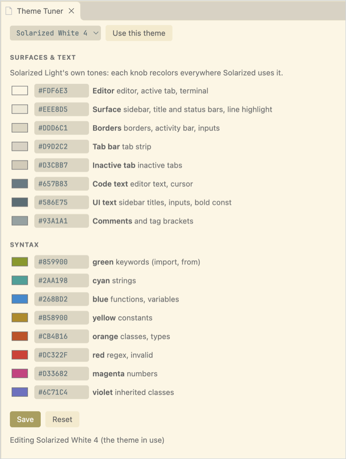
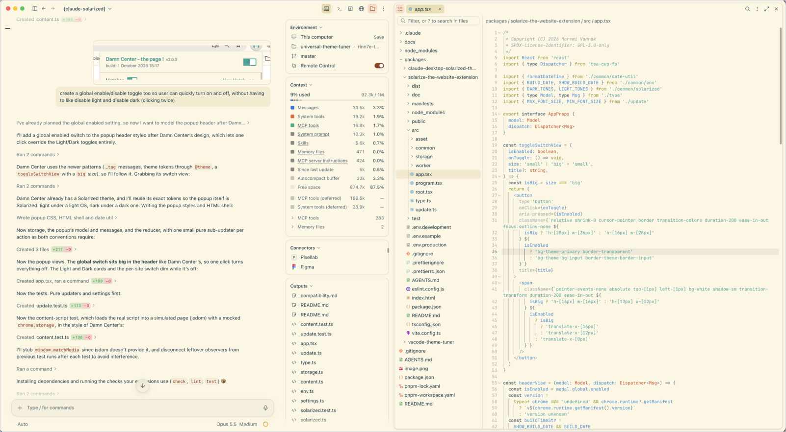
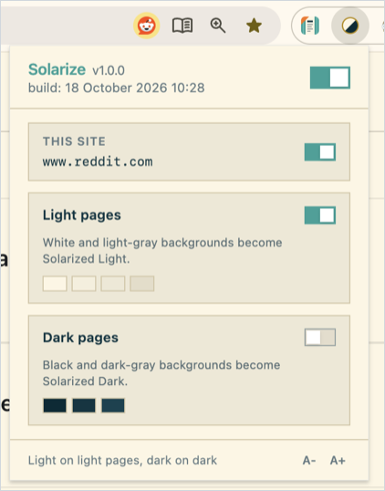
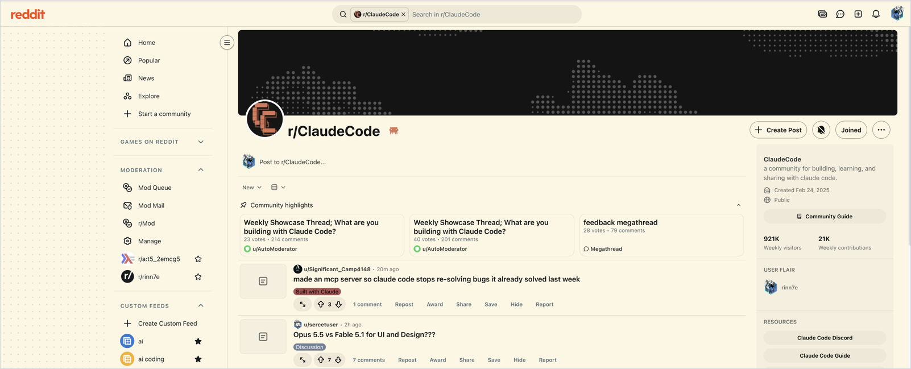

# Universal Theme Tuner

Theme tuners and themes for the apps you use, one package each:

| Package | What it is |
| --- | --- |
| [`vscode-theme-tuner`](packages/vscode-theme-tuner) | The Solarized White (1–4) and Groovy Lambda Black VS Code themes, and the Theme Tuner panel that previews color changes live |
| [`claude-desktop-solarized-theme`](packages/claude-desktop-solarized-theme) | Solarized Light for the Claude desktop app, applied as a DevTools snippet |
| [`solarize-the-website-extension`](packages/solarize-the-website-extension) | Solarize, a Chrome/Firefox/Safari extension that recolors websites with Solarized |

## Screenshots

### VS Code: the Theme Tuner

The Theme Tuner panel editing Solarized White 4: surface and text tones on top,
the eight syntax accents below, each previewed live in the editor.

<p align="center">
  
</p>

### Claude desktop app

The Claude desktop app with the Solarized Light theme.

<p align="center">
  
</p>

### Websites: Solarize

The Solarize popup, with the global switch, the per-site switch and the
Light pages / Dark pages toggles:

<p align="center">
  
</p>

Reddit recolored by Solarize, including its web components:

<p align="center">
  
</p>

## Development

A pnpm workspace (Node.js 24+):

```bash
pnpm install
pnpm run build   # builds every package
pnpm run test    # runs the packages that have tests
```

Each package also builds on its own, for example
`pnpm --filter ./packages/vscode-theme-tuner run build`.

## License

[MIT](LICENSE). Two packages also build on others' MIT-licensed work,
credited in their own notices:
[`LICENSE-vscode`](packages/vscode-theme-tuner/LICENSE-vscode) (VS Code's
Solarized Light),
[`LICENSE-groovy-lambda`](packages/vscode-theme-tuner/LICENSE-groovy-lambda)
(Groovy Lambda) and
[`LICENSE-clay`](packages/claude-desktop-solarized-theme/LICENSE-clay) (Clay).
